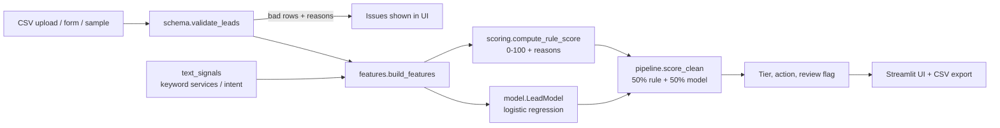

# Technical Approach — LeadIQ

Everything below describes what is **implemented** unless it sits under "Future work".

## 1. Problem definition

Given a lead record (contact, company, budget, timeline, source, free-text message), output a 0–100 priority score, a Hot/Warm/Cold tier, the reasons, the likely Cynbit service line, and a suggested action. Constraint: must run locally without paid APIs or credentials.

## 2. Architecture

**Type: hybrid of transparent rules + a small trained ML model. No LLM and no RAG.**

## 3. Technology choices

| Choice | Why |
|---|---|
| Python, pandas | Standard for tabular data work |
| scikit-learn LogisticRegression | Small tabular data; coefficients are inspectable; trains in under a second |
| Hand-written rules | Explainable to sales staff; works with zero training data |
| Keyword matching, not an LLM | Cheap, deterministic, no API cost; an LLM is only justified if it beats keywords on real held-out data |
| Streamlit | Fast, reviewable demo UI |
| pytest | Unit and pipeline tests |

## 4. Data

- **Schema** (`schema.py`): `lead_id, name, title, company, email, company_size, industry, source, budget_inr, timeline, message`.
- **Validation**: required columns; non-empty; valid email format; `company_size`, `source`, `timeline` from fixed lists (case/whitespace normalised); non-negative numeric budget; unique `lead_id`. Bad rows are dropped and reported with CSV row numbers; an unusable file raises `LeadDataError`.
- **Sample data**: `data/sample_leads.csv`, 60 fake leads from `synthetic.generate_leads(60, seed=7)`.
- **Training data**: 3,000 fake leads generated at startup (seed 42). The `converted` label is drawn from an assumed logistic process (weights differ from the rule scorer). **It encodes my assumptions, not Cynbit's reality.**
- **Storage**: none; nothing is persisted.

## 5. Pipeline and inference

1. Validate → 2. Features (`FEATURE_COLUMNS`: log budget, size rank, timeline rank, seniority, source quality, business email, intent hits, low-intent hits, service count, message length) → 3. Rule score: points per signal, e.g. budget up to 25, timeline 20, seniority 15, size 10, source 10, intent wording up to 15, business email 5, minus up to 15 for low-intent wording; clipped to 0–100 → 4. Model probability → 5. `final = 0.5·rule + 0.5·100·probability` → 6. Tier: ≥60 Hot, ≥35 Warm, else Cold → 7. `needs_review` when |rule − 100·probability| ≥ 30 → 8. Suggested action; training-only or strongly low-intent messages route to BitElevate.

Source-quality values and rule weights are **judgement calls**, not fitted to real data.

## 6–7. Prompt engineering / RAG

Not used. No prompts, embeddings or retrieval exist in this MVP.

## 8. Model training and validation

Stratified 70/30 split of 3,000 synthetic leads; `StandardScaler` + `LogisticRegression` (`random_state=42`). The app's model is trained on all 3,000 at startup. Per-lead "drivers" are the top positive standardised-coefficient × value contributions.

## 9. API design

None. The UI calls `score_leads(df)` directly.

## 10. Security, privacy, responsible AI

- No credentials, network calls, or `.env` needed; no secrets in the repo.
- Uploaded data stays in the Streamlit session; nothing is logged or stored.
- Real use would need consent, retention limits and access control for personal data.
- Features like email domain and company size can disadvantage small genuine buyers. Mitigations: reasons shown per lead, review flag, humans decide.
- Synthetic labels mean no claim of real accuracy or fairness is made.

## 11. Error handling

Unreadable CSV → error message; missing columns/empty/no valid rows → `LeadDataError` shown in UI; invalid rows skipped and listed; single-lead form errors shown inline; empty states for no upload and no tier matches.

## 12. Testing and measured results

`pytest`: **25 tests passing** (run 15 Oct 2026) covering validation edge cases, text signals, scoring bounds/penalties, model input checks, pipeline ordering and output, and that Hot > Warm > Cold conversion on a synthetic hold-out. The Streamlit app was smoke-run headlessly with Streamlit's `AppTest` (no exceptions, 60 sample leads scored). It was **not** tested in a real browser or on mobile.

Hold-out evaluation (`python scripts/evaluate.py`; 900 synthetic test leads, base rate 25.0%):

| Score | ROC-AUC | Avg. precision | Precision @ top 20% | Lift @ top 20% |
|---|---|---|---|---|
| Rule score | 0.772 | 0.548 | 0.539 | 2.16× |
| Model only | 0.780 | 0.576 | 0.556 | 2.22× |
| Blended (used) | 0.780 | 0.576 | 0.544 | 2.18× |

Conversion by tier on the blended score: Hot 74.4% (78 leads), Warm 35.9% (320), Cold 10.4% (502).

**Interpretation:** The model is only slightly better than the rules. These numbers confirm the code ranks leads according to the *assumed* generating process; they are **not evidence of real-world performance**.

## 13. Setup

See README: create venv, `pip install -r requirements.txt`, `streamlit run app.py`, `python -m pytest`. Not deployed anywhere.

## 14. Execution plan if Cynbit adopted it

| Milestone | Work |
|---|---|
| Week 1 | Interview sales/marketing; get lead export and won/lost history; agree definitions |
| Week 2 | Retrain and recalibrate on real data; compare to current triage |
| Week 3–4 | Shadow mode alongside manual triage; measure time-to-contact and conversion |
| Week 5+ | CRM integration, monitoring, review of fairness |

## 15. Scale and cost

Scoring is CPU-only and scales to tens of thousands of rows per run on a laptop (row-wise rule scoring is the slowest part and can be vectorised). Cost: hosting only; no per-call API fees.

## 16. Limitations and future work

**Limitations:** synthetic data and labels; keyword matching; fixed English vocabulary; judgement-based weights; no probability calibration; no authentication; no persistence.

**Future work (not built):** retrain on real data; calibration; CRM connectors; optional LLM for intent extraction/summaries behind a feature flag with fallback to keywords; drift monitoring; fairness audits.
